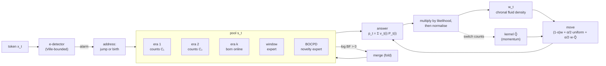

<h1 align="center">Asmodeus ०</h1>

<p align="center"><b>A time traveller on a chronal fluid.</b><br/>
A softmax decider that answers alone, and goes back to an era when it needs that era's knowledge.</p>

<p align="center"><a href="https://teerth.blog/asmodeus"><b>Read the essay at teerth.blog/asmodeus</b></a> &nbsp;·&nbsp; <a href="https://blog.teerth.dev/asmodeus/">project page</a></p>

<p align="center"><i>Asmodeus, king of demons, commands a legion. None of them is anywhere until it is called by name.<br/>
Called, one appears, does its work in its own corner of time, and is gone.</i></p>

<p align="center">
  
  
  
  
  
  
</p>

**Invented by [Teerth Sharma](https://teerthsharma.vercel.app/)** · teerths57@gmail.com

---

## Contents

1. [Abstract](#1-abstract)
2. [Status at a glance](#2-status-at-a-glance)
3. [The idea, in the inventor's words](#3-the-idea-in-the-inventors-words)
4. [Definitions](#4-definitions)
5. [The architecture, one token at a time](#5-the-architecture-one-token-at-a-time)
6. [What has been measured](#6-what-has-been-measured)
7. [What has been proved](#7-what-has-been-proved)
8. [FCPA: the fluid-dynamics line](#8-fcpa-the-fluid-dynamics-line)
9. [Roadmap: 14 stages, and where we are](#9-roadmap-14-stages-and-where-we-are)
10. [How the research is run](#10-how-the-research-is-run)
11. [What we got wrong, and what it taught](#11-what-we-got-wrong-and-what-it-taught)
12. [Honest limits](#12-honest-limits)
13. [Reproduce](#13-reproduce)
14. [Repository layout](#14-repository-layout)
15. [Glossary](#15-glossary)
16. [License](#16-license)

Every claim below links to the file, verdict or pull request that backs it. A number with no link is a bug in this README.

---

## 1. Abstract

Data is not one distribution. It is a **chronal fluid**: a stream whose governing law changes from one stretch of time to the next and, often, comes back. Asmodeus ० cuts the stream into **eras**. An era is a small statistical model that holds the knowledge of one law. A softmax decider, the **time traveller (TT)**, keeps a weight $w_t$ over the eras. That weight is the **chronal fluid data density**: where the TT stands in the liquid of eras at time $t$. Each token moves it by one rule, *multiply by the likelihood, then normalise*, and it carries **momentum**: the weight flows along a learned era-to-era kernel, so where the TT came from predicts where it goes next.

New eras are born online under an anytime-valid change detector whose false-alarm rate is bounded by Ville's inequality. Two eras that turn out to hold the same law are merged by a Bayes factor that is provably the same rule as the address step. Old eras are never overwritten, so nothing settled is forgotten.

On switching-law streams with recurring regimes, the era bank with the momentum decider (**MOM**) has **11× lower regret** than the best owned online learner ([`VERDICT_E0.md`](zero/research/VERDICT_E0.md)), beats uniform fixed share on **10 of 10** fresh seeds ([`VERDICT_TOURNAMENT.md`](zero/research/VERDICT_TOURNAMENT.md)), and has **15× lower regret** than a 0.86M-parameter meta-trained transformer that reads the regime from its context ([`VERDICT_E1.md`](zero/research/VERDICT_E1.md)). The regret bound, the merge rule, no forgetting and the momentum filter are **proved in Lean 4** with no `sorry` ([`ERA_LEMMAS.md`](zero/lean/ERA_LEMMAS.md), [PR #26](https://github.com/teerthsharma/Asmodeus/pull/26), [PR #30](https://github.com/teerthsharma/Asmodeus/pull/30)), together with a finite-sample merge threshold and the learned kernel's regret.

Phase 0 (research) is closed. Phase 1 (Lean, a GPU engine, a real-text pilot) is in progress ([`ROADMAP.md`](zero/research/ROADMAP.md)).

---

## 2. Status at a glance

| | State | Evidence |
|---|---|---|
| **Architecture of record** | E0c era bank + **MOM** decider, α = 0.003 | [`VERDICT_TOURNAMENT.md`](zero/research/VERDICT_TOURNAMENT.md), [PR #23](https://github.com/teerthsharma/Asmodeus/pull/23) |
| **Phase 0 (stages 0–4)** | ✓ done | [`ROADMAP.md`](zero/research/ROADMAP.md) |
| **Stage 5, Lean** | ◐ L38–L42 proved, incl. merge threshold and learned kernel | [`ERA_LEMMAS.md`](zero/lean/ERA_LEMMAS.md), [PR #26](https://github.com/teerthsharma/Asmodeus/pull/26), [PR #30](https://github.com/teerthsharma/Asmodeus/pull/30) |
| **Stage 6, GPU engine** | ○ in build; interface frozen | [`phase2/INTERFACE.md`](zero/research/phase2/INTERFACE.md) |
| **Stage 7, TinyStories pilot** | ○ next | [`ROADMAP.md`](zero/research/ROADMAP.md) §Stage 7 |
| **Regret vs best owned learner** | 0.028 vs 0.305 nats/token (11×) | [`VERDICT_E0.md`](zero/research/VERDICT_E0.md) |
| **MOM vs SOFT** | 10/10 paired fresh seeds, −5.6% | [`VERDICT_TOURNAMENT.md`](zero/research/VERDICT_TOURNAMENT.md) |
| **ERA vs context readers** | 0.027 vs 0.463 (15×), 10/10 seeds | [`VERDICT_E1.md`](zero/research/VERDICT_E1.md) |
| **Lean** | 43 files, 0 `sorry` | [`zero/lean/FCPA/`](zero/lean/FCPA/), [`check_no_sorry.py`](zero/lean/check_no_sorry.py) |
| **FCPA estimator** | launch unblocked; Amendment 11c frozen; L37 era model next | [`FREEZE4.md`](zero/docs/specs/FREEZE4.md), [PR #25](https://github.com/teerthsharma/Asmodeus/pull/25) |

```
PHASE 0  research          0 ✓  1 ✓  2 ✓  3 ✓  4 ✓
PHASE 1  build and prove   5 ◐  6 ○  7 ○                  <- we are here
PHASE 2+ compare and scale 8 ○  9 ○  10 ○  11 ○  12 ○  13 ○   (Seal, later)
✓ done   ◐ in progress   ○ not started
```

---

## 3. The idea, in the inventor's words

The design comes from two handwritten notes, "AT I ०" and "That if we combine", transcribed in full in [`origin_notes_transcription.md`](zero/research/origin_notes_transcription.md). The originals are in [`zero/ref/origin/`](zero/ref/origin/).

> our softmax is a TT (Time Traveller),
> is smart alone, but when he needs knowledge
> of a particular era he goes back in time;
> his TT contains only results
> of history; the era contains
> knowledge, like a JEPA.

> what I mean is we will provide the time travel a dimensional phase;
> when this momentum will be like in a dimension of "liquid" …
> so we will get liquid of JEPA.

> **fluid chrononal predictive architecture**
> (after multiplication and normalisation)

> That's what the aim of this research is → LEMMA and LEAN → BUILD → PROVEN ✓

The constraints, from "AT I ०":

- **New design: not JEPA, nor self attention.** Eras may be any predictor; the decider is a softmax.
- **"The internal design of this should also be butterfly effect bonded via topology."** One token's influence on the decider is bounded (L38 `butterfly`, §7).
- **Method: research → lemma and Lean → build → proven.** A measured result is *measured*, not *proven*, until its lemma compiles in Lean.

Every term below is read from these notes. Where a formal definition goes beyond the notes, [`PROGRAM.md`](zero/research/PROGRAM.md) Addendum 2 records the choice.

---

## 4. Definitions

### Time traveller (TT)

The softmax decider. It holds a weight vector $w_t$ over a pool of experts and answers with their blend. It "is smart alone": when one expert carries almost all the weight, it answers with that expert and spends no compute on the rest. When it "needs knowledge of a particular era", the weight moves there. It "contains only results of history": the TT keeps no raw past, only $w_t$ and the eras' sufficient statistics.

Source: notes p3; FCPA design D7 ([`2026-10-11-fcpa-design.md`](zero/docs/specs/2026-10-11-fcpa-design.md)); [`PROGRAM.md`](zero/research/PROGRAM.md) §0 and Addendum 2.

### Era

A maximal stretch of time with one constant law, and the small model that holds that law's knowledge. In the reference code an era is an order-1 count table $C_k \in \mathbb{N}^{V\times V}$ with a Dirichlet prior:

$$p_k(x \mid x') = \frac{C_k[x',x] + a}{\sum_y C_k[x',y] + aV}, \qquad a = 0.2.$$

Counts are additive sufficient statistics, so an era updated online equals the era fitted in batch (L27, `partial_fit = fit`). Source: [`PROGRAM.md`](zero/research/PROGRAM.md) §3; [`e0/arms.py`](zero/research/e0/arms.py).

### The pool

The TT weighs the bank of eras plus two tail experts:

- a **window** model on the last $w$ tokens (fast, local);
- a **BOCPD** expert (run-length posterior, Adams–MacKay 2007), the novelty expert that covers a law no era has seen.

Source: [`e0/deciders.py`](zero/research/e0/deciders.py) docstring; [`VERDICT_E0.md`](zero/research/VERDICT_E0.md).

### Chronal fluid data density, $w_t$

The TT's softmax weight over the pool at time $t$: where the TT stands in the "liquid of eras". Its path through time is the "path of softmax" of the notes. Births add eras to the liquid; merges fuse two of them.

Source: [`PROGRAM.md`](zero/research/PROGRAM.md) Addendum 2, which replaces the earlier reading (the data's own law density, Addendum 1, withdrawn).

### "After multiplication and normalisation"

The Bayes step of a forward filter:

$$u_t(i) \;=\; \frac{v_t(i)\,P_t(i)(x_t)}{\sum_j v_t(j)\,P_t(j)(x_t)},$$

where $v_t$ is the weight after the move (below) and $P_t(i)(x_t)$ is expert $i$'s probability of the token that arrived. Source: [`PROGRAM.md`](zero/research/PROGRAM.md) Addendum 2; `Soft.step` in [`e0/deciders.py`](zero/research/e0/deciders.py).

### Momentum (MOM)

"Its momentum will be like in a dimension of liquid." Before each token, a share $\alpha$ of the weight moves. Half of it spreads uniformly. The other half of each era's share travels along a learned era-to-era kernel $\tilde Q$:

$$v_t \;=\; (1-\alpha)\,w_t \;+\; \frac{\alpha/2}{|s_t|}\,\mathbf{1} \;+\; \frac{\alpha}{2}\,w_t^{\text{eras}}\,\tilde Q,$$

with $\tilde Q$ the row-normalised, Dirichlet(1)-smoothed counts of the era switches seen so far (diagonal zero). The incumbent it replaced, **SOFT** (fixed share, Herbster–Warmuth 1998), is the same move with $\tilde Q$ replaced by uniform spreading. Source: `Momentum.share` in [`e0/deciders.py`](zero/research/e0/deciders.py); L41 in [`ERA_LEMMAS.md`](zero/lean/ERA_LEMMAS.md).

### Birth

A mixture e-detector (Shin–Ramdas–Rinaldo) watches the active era $A$ with e-values $e_t = F_t(x_t)/A_t(x_t)$, $F_t = \lambda A_t + (1-\lambda)W_t$. Since $\mathbb{E}[e_t \mid \text{past}] = 1$ when $x_t \sim A_t$,

$$S_t = \Big(S_{t-1} + \tfrac{1}{t(t+1)}\Big)\,e_t, \qquad M_t = S_t + \tfrac{1}{t+1}$$

is a test martingale, and by Ville's inequality $\Pr(\exists t: M_t \ge 1/\delta) \le \delta$. On an alarm the window is **addressed**: its prequential likelihood under each bank era is compared with a fresh era's marginal likelihood. The best bank era wins → **jump**; the fresh era wins → **birth**. A birth leaves every old era's table unchanged (L23). Source: [`PROGRAM.md`](zero/research/PROGRAM.md) §3; `_Detector` and `fcpa` in [`e0/arms.py`](zero/research/e0/arms.py).

### Merge

Two eras $C$, $D$ fuse when the Dirichlet–multinomial Bayes factor favours one law:

$$\log \mathrm{BF} \;=\; \log \mathrm{ML}(C+D) - \log \mathrm{ML}(C) - \log \mathrm{ML}(D) \;>\; 0,$$

checked globally over all pairs, and only after an era holds $n_{\min} = 64$ transitions of evidence. L39 proves this is the address rule applied to a whole era. Source: [`E0c_PREREG.md`](zero/research/E0c_PREREG.md); L39 in [`ERA_LEMMAS.md`](zero/lean/ERA_LEMMAS.md).

---

## 5. The architecture, one token at a time



Per token, exactly as the reference code runs it ([`e0/deciders.py`](zero/research/e0/deciders.py), [`e0/arms.py`](zero/research/e0/arms.py)):

```text
for each token x_t:
    v   = move(w)                       # MOM: (1-α)w + (α/2)/|s| + (α/2)·w_eras·Q̃
    p_t = Σ_i v(i) · P_i(x_t | x_{t-1})  # the TT's answer (HARD: top expert alone if v_max ≥ θ)
    w   = normalise(v ⊙ P(x_t))         # "after multiplication and normalisation"
    credit x_t to the active era's counts
    if detector alarms:                 # M_t ≥ 1/δ
        address the window → jump to a bank era, or birth a fresh era
        if jump a→b: Q̃ counts[a,b] += 1
        birth: w ← (1-α)w ⊕ [α]        # old tables untouched (L23)
    every era with ≥ n_min evidence: merge pairs with log BF > 0, w(i) += w(j)
```

What each piece buys:

| Piece | Job | Without it | Evidence |
|---|---|---|---|
| Era bank | remembers every law for the whole stream | re-learns a law on every return | E0: re-entry excess 0.084 vs 0.70 for BOCPD |
| Forward filter (Bayes step) | sharp routing from the likelihood product | the active era alone: 0.125 vs 0.034 | [`VERDICT_E0.md`](zero/research/VERDICT_E0.md) diagnosis |
| BOCPD novelty expert | covers laws no era has seen | 3.71× BOCPD's regret on NOREC | E0 B2 FAIL → E0b B2 PASS |
| Global merge + $n_{\min}$ | one era per law | 4–8 eras for 4 laws | E0b B3 FAIL → E0c PASS |
| MOM kernel | uses the order in which laws recur | −5.6% regret lost | [`VERDICT_TOURNAMENT.md`](zero/research/VERDICT_TOURNAMENT.md) |
| HARD threshold | one era answers alone | no compute saving | alone on 45.8% of steps at no loss |

---

## 6. What has been measured

All numbers are regret against an **oracle** that knows the true regime, in nats per token, averaged over **fresh evaluation seeds** never used for tuning. Every bar was frozen by sha256 before its result existed ([`e0/FREEZE.txt`](zero/research/e0/FREEZE.txt)).

### The beds

Generator [`e0/bed.py`](zero/research/e0/bed.py). V = 16 symbols, order-1 laws with rows ~ Dirichlet(0.2·1), T = 20,000 tokens ([`PROGRAM.md`](zero/research/PROGRAM.md) §6, [`E0d_PREREG.md`](zero/research/E0d_PREREG.md)).

| Bed | What it is | What it tests |
|---|---|---|
| REC | 4 laws that recur; segments 50 + Geometric(350) | memory of returning regimes |
| NOREC | every segment a fresh law | the cost of memory when nothing returns |
| NULL | one law, no switches | false births |
| CYC | 4 laws; the next is the cyclic successor with p = 0.9 | whether the order of eras can be learned |
| CYC-S | CYC with short segments, 20 + Geometric(100) | fast switching |

### E0, E0b, E0c: does the era mechanism pay? (stage 2)

Source: [`VERDICT_E0.md`](zero/research/VERDICT_E0.md), [`e0/RESULTS.md`](zero/research/e0/RESULTS.md), [`RESULTS_E0b.md`](zero/research/e0/RESULTS_E0b.md), [`RESULTS_E0c.md`](zero/research/e0/RESULTS_E0c.md).

| Bar | E0 (seeds 0–9) | E0b (seeds 10–19) | **E0c (seeds 20–29)** |
|---|---|---|---|
| B1: REC regret ≤ 0.5 × best owned | PASS 10/10 (0.11×) | PASS 10/10 (0.09×) | **PASS 10/10** (0.0277 vs 0.3056) |
| B2: no cost without recurrence | FAIL (3.71× BOCPD) | PASS (1.17×) | **PASS (1.18×)** |
| B3: birth control | FAIL (7–11 eras) | FAIL (4–8 eras) | **PASS** (exactly 4 on 8/10, 0 null births) |
| B4: no forgetting | PASS (0.086) | PASS (0.084) | **PASS** (0.084 vs 0.347 allowed) |

- **11× lower regret** than BOCPD, the best owned learner (0.028 vs 0.305).
- **No forgetting:** re-entering a seen regime costs 0.084 nats over the oracle, against 0.70 for BOCPD and 0.86 for EMA.
- **No false eras:** 0 spurious births over 20 null seeds.
- **Parameter count does not explain it:** GLOBAL-o2 holds 4,352 counts and loses (regret 0.42).

### E0d, E0e: the decider tournament (stage 3)

Six ways for the TT to move $w_t$, each resting on a lemma already in the record, on the same era bank. Source: [`VERDICT_TOURNAMENT.md`](zero/research/VERDICT_TOURNAMENT.md), [`E0d_PREREG.md`](zero/research/E0d_PREREG.md), [`E0e_PREREG.md`](zero/research/E0e_PREREG.md).

| Decider (lemma) | Round 2, seeds 40–49 | Verdict |
|---|---|---|
| SOFT (L14′ fixed share) | 0.0515, all gates | incumbent |
| **MOM (D3 Markov law over eras)** | **0.0486, all gates, 10/10 vs SOFT** | **winner** |
| MOM+GB | 0.0489, all gates | ties MOM; the extra knob buys nothing |
| GBAYES (tempered likelihood) | 0.0523 | no gain |
| TEMP (L4 temperature) | 0.0516, fails G2 | no gain |
| CTC (L32 Hilbert fixed point) | 0.0520, fails G2 | adds nothing; L32 predicted it |
| HARD (L5 top expert) | 0.0516 ≈ SOFT | **alone on 45.8% of steps**: a compute result |

- MOM's gain is largest where eras follow a path: CYC −7%, CYC-S −6%, NOREC −8%, REC −2%.
- **Round 2 is disclosed:** round 1's tuning objective left out NOREC and pushed every decider to α = 0.01, which broke gate G2. Round 2 changed only the objective, was preregistered, and ran on fresh seeds. L38 later explained the failure exactly (§7).

### E1: era bank vs models that read the regime from context (stage 4)

The real competitor is in-context inference. Source: [`VERDICT_E1.md`](zero/research/VERDICT_E1.md), [`e1/out/RESULTS_E1.md`](zero/research/e1/out/RESULTS_E1.md), [`E1_PREREG.md`](zero/research/E1_PREREG.md), [`E1_AMEND1.md`](zero/research/E1_AMEND1.md). Fresh seeds 50–59.

| Arm | Params | REC | CYC-S | NOREC |
|---|---|---|---|---|
| **ERA** (E0c bank + MOM) | counts | **0.027** | **0.148** | **0.019** |
| TF-META (meta-trained transformer, 50M tokens) | 0.86M | 0.463 | 0.705 | 0.182 |
| GRU-ONLINE-L | 17k | 0.688 | 0.660 | 0.750 |
| GRU-ONLINE-S | 1.9k | 0.740 | 0.717 | 0.776 |
| GRU-META | 0.21M | 1.023 | 1.048 | 0.714 |

- **C5 holds:** bars E1-B1 (REC) and E1-B2 (CYC-S) pass on 10 of 10 seeds.
- **Why:** each regime is a fresh 16 × 16 table. TF-META sees 512 tokens, about 5 short segments on CYC-S, too few to estimate a table. ERA keeps every regime's counts for the whole stream and returns to them. The two differ in what they can remember, not in tuning.
- **Limit:** GRU-META never learned in context under the frozen recipe. The bars did not depend on it.

---

## 7. What has been proved

"Proven" here means a lemma that compiles in Lean 4 with no `sorry`, `axiom`, `admit` or `native_decide` ([`lean/CHANGES.md`](zero/lean/CHANGES.md)). Toolchain `leanprover/lean4:v4.7.0` with a pinned Mathlib ([`lean-toolchain`](zero/lean/lean-toolchain), [`lakefile.lean`](zero/lean/lakefile.lean)).

### The era lemmas, L38–L42 ([PR #26](https://github.com/teerthsharma/Asmodeus/pull/26), [PR #30](https://github.com/teerthsharma/Asmodeus/pull/30))

Full statements and proofs: [`ERA_LEMMAS.md`](zero/lean/ERA_LEMMAS.md). The objects are the code in [`zero/research/e0/`](zero/research/e0/), not an idealisation of it.

| Lemma | Claim | Status | Lean |
|---|---|---|---|
| **L38** | Regret of the TT filter over a bank that grows by births and shrinks by merges, for any linear decider (SOFT, MOM) | **PROVED**, pathwise | [`L38_GrowingBankRegret.lean`](zero/lean/FCPA/L38_GrowingBankRegret.lean) |
| **L39** | Merge rule = address rule on a whole era; both directions agree; BF is an e-value | **PROVED** | [`L39_MergeRule.lean`](zero/lean/FCPA/L39_MergeRule.lean) |
| **L39c** | $\log \mathrm{BF} = -\mathrm{Div} + \mathrm{Gain} \pm K$: divergence linear in evidence, Occam gain logarithmic | **PROVED** (deterministic); sampling bridge cited | [`L39c_MergeConsistency.lean`](zero/lean/FCPA/L39c_MergeConsistency.lean) |
| **L40** | No forgetting for count eras | **PROVED** for settled tokens; unconditional form FALSE | [`L40_NoForgetting.lean`](zero/lean/FCPA/L40_NoForgetting.lean) |
| **L41** | MOM is an HMM forward filter; switch cost $-\log((\alpha/2)\tilde Q(j,i))$, learned $\tilde Q$ included | **PROVED** | [`L41_Momentum.lean`](zero/lean/FCPA/L41_Momentum.lean) |
| **L39d** | Merge iff $\mathrm{BF}_j \ge (j+1)(j+2)/\delta$: P(any false merge, any pair, any time) ≤ δ; no uniform guarantee exists for a fixed threshold | **PROVED** | [`L39d_MergeThreshold.lean`](zero/lean/FCPA/L39d_MergeThreshold.lean) |
| **L41b** | Learned $\tilde Q$ is within $(k-1)\log(n+1)$ of the best fixed kernel, on any switch sequence | **PROVED**; parameter rate cited | [`L41b_LearnedKernel.lean`](zero/lean/FCPA/L41b_LearnedKernel.lean) |
| **L42** | The shipped filter: log-space Bayes is exact; HARD routing costs ≤ $\log(\theta + (1-\theta)/\varepsilon)$ per HARD step | **PROVED** | [`L42_ShippedFilter.lean`](zero/lean/FCPA/L42_ShippedFilter.lean) |

**L38, the bound.** For every token sequence, every expert prediction sequence, every birth/merge schedule and every comparator path $c_t \in s_t$:

$$\sum_{t\le T} -\log p_t \;\le\; \sum_{t\le T} -\log P_t(c_t) \;+\; \log\frac{|s_0|}{1-\alpha+\rho} \;+\; \sum_{t<T}\mathrm{cost}_t,$$

with a switch $j \to i$ costing at most $-\log\max\!\big(\rho/N,\ K(j,i)(1-\alpha)^{b_t}\big) \le \log(N/\rho)$. SOFT is $\rho = \alpha, K = 0$; MOM is $\rho = \alpha/2,\ K = (\alpha/2)\tilde Q$.

**What the theorems change in the design:**

- **The "free when nothing recurs" gate is now a theorem.** Overhead vs BOCPD is at most $\alpha/(1-\alpha)$ per token for SOFT and about $\alpha/2$ for MOM. Gate G2 is guaranteed for **α ≤ 0.0039 (SOFT) or α ≤ 0.0078 (MOM)**. Round 1 picked α = 0.01, outside the range, and five of six deciders failed G2; round 2's α = 0.003 is inside, and both passed. On NOREC the bound is nearly tight (MOM measured 0.0012–0.0015 per token, bound 0.0016).
- **The butterfly is bounded.** One token moves $\log w(i)$ by at most $\log(\max P/\min P)$ (L38 `butterfly`). This is the notes' "butterfly effect bonded via topology", made a number.
- **The merge threshold now has a finite-sample guarantee.** The coded BF > 1 means δ = 1 (`threshold_one_vacuous`). L39d proves that merging only when $\mathrm{BF}_j \ge (j+1)(j+2)/\delta$ bounds the chance of any false merge, over any pair and any time, by δ. $n_{\min} = 64$ is still tuned, not derived.
- **No forgetting holds for settled tokens only.** A re-address can move a recent token out of an era. The unconditional statement is false, with a counterexample in [`ERA_LEMMAS.md`](zero/lean/ERA_LEMMAS.md).
- **MOM is exactly an HMM forward filter**, so a batched log-space forward pass, or a parallel scan, computes it with no approximation. This is what the stage 6 engine relies on.

**Still cited, not formalised:** how fast the learned $\tilde Q$ approaches the true switch law (needs Hoeffding for chains), and L39c's sampling bridge ([`ERA_LEMMAS.md`](zero/lean/ERA_LEMMAS.md)).

### The FCPA lemma chain, L1–L37

The TT and the era bank grew out of FCPA, whose lemmas are proved in the same Lean project ([`lean/CHANGES.md`](zero/lean/CHANGES.md)). The ones the chronal-fluid line stands on:

| Lemma | What it gives the TT | Lean |
|---|---|---|
| L1 | Born probabilities need no partition function, so lazy top-m routing is exact | [`L01_BornExactness`](zero/lean/FCPA/L01_BornExactness.lean) |
| L5 | certified top-m: when one expert can answer alone | [`L05_CertifiedTopM`](zero/lean/FCPA/L05_CertifiedTopM.lean) |
| L6, L7 | split-conformal and adaptive conformal coverage | [`L06_SplitConformal`](zero/lean/FCPA/L06_SplitConformal.lean), [`L07_ACICoverage`](zero/lean/FCPA/L07_ACICoverage.lean) |
| L14, L14b | the address step; the HMM forward filter | [`L14_Address`](zero/lean/FCPA/L14_Address.lean), [`L14b_HMMFilter`](zero/lean/FCPA/L14b_HMMFilter.lean) |
| L22, L22H | the CTC return trip: damped and Hilbert fixed points | [`L22_DampedLoop`](zero/lean/FCPA/L22_DampedLoop.lean), [`L22H2_HilbertFixedPoint`](zero/lean/FCPA/L22H2_HilbertFixedPoint.lean) |
| L23 | non-destructive birth: old eras are unchanged when a new one is born | [`L23_NonDestructiveBirth`](zero/lean/FCPA/L23_NonDestructiveBirth.lean) |
| L24 | Ville bound on false births; birth e-process | [`L24s_Ville`](zero/lean/FCPA/L24s_Ville.lean), [`L24b_BirthEProcess`](zero/lean/FCPA/L24b_BirthEProcess.lean) |
| L27 | exact `partial_fit` = `fit` from additive statistics | [`L27_PartialFit`](zero/lean/FCPA/L27_PartialFit.lean) |

L32 (a contracting CTC loop has tilt cap $w^\star_{\max}/w^\star_{\min} \le e^{2q}$, so it cannot be a sharp decider) **predicted** that CTC would add nothing as the TT's answer. The tournament confirmed it. The CTC loop keeps its role as the TT's provable return trip, not its decider ([`PROGRAM.md`](zero/research/PROGRAM.md) §1, Addendum 1).

---

## 8. FCPA: the fluid-dynamics line

**FCPA, the Fluid Chrononal Predictive Architecture**, is the name in the notes. It applies the same idea to continuous fields: a stream of 2-D Navier–Stokes trajectories whose viscosity and forcing change between eras. It is implemented as one scikit-learn estimator, `FCPARegressor`, that passes `check_estimator` and whose `partial_fit` equals `fit` exactly ([`fcpa/API.md`](zero/fcpa/API.md), [`fcpa/estimator.py`](zero/fcpa/estimator.py)).

$$\text{era law:}\quad \partial_t\omega + u\cdot\nabla\omega = \nu_k\,\Delta\omega + f_k,\qquad \hat\nu_k = \frac{S_{RL}}{S_{LL}}\ \ \text{(exact projection, L8)}$$

$$\text{address:}\quad \Delta E_{jk} = (\nu_k-\nu_j,\ f_k-f_j,\ P_k-P_j)\quad\text{(L13, L14)}$$

| Piece | State | Evidence |
|---|---|---|
| Spec and lemmas | L1–L37, Amendments A–D | [`2026-10-11-fcpa-design.md`](zero/docs/specs/2026-10-11-fcpa-design.md), [`fcpa-amendment-D.md`](zero/docs/specs/2026-10-11-fcpa-amendment-D.md) |
| Estimator | numpy / scipy / scikit-learn; one test per lemma | [`zero/fcpa/`](zero/fcpa/), [`fcpa/tests/`](zero/fcpa/tests/) |
| Preregistration | Amendments 11, 11a, 11b, 11c frozen by sha256 before any evaluation | [`FREEZE.md`](zero/docs/specs/FREEZE.md) … [`FREEZE4.md`](zero/docs/specs/FREEZE4.md) |
| Calibration | trajectory-level calibration (L36 route R1) frozen as Amendment 11c | [`PREREG_AMENDMENT_11c.md`](zero/docs/specs/PREREG_AMENDMENT_11c.md), [PR #25](https://github.com/teerthsharma/Asmodeus/pull/25) |
| Open blocker | a linear era model cannot beat persistence at 50 steps (L28, L29). The fix is L37, the shift-equivariant quadratic era ridge | [`L37_shift_equivariant_era_ridge.md`](zero/docs/specs/theory/L37_shift_equivariant_era_ridge.md) |

FCPA and the TT line share their spine: eras of additive statistics, non-destructive birth, Ville-bounded change detection, and a softmax that routes between eras. The NS-2D bed tests the mechanism through a hard regression problem (quadratic advection over 50 steps), so [`PROGRAM.md`](zero/research/PROGRAM.md) §1 split the program: the switching-Markov beds isolate the mechanism, and FCPA carries the fluid claim.

---

## 9. Roadmap: 14 stages, and where we are

The full roadmap, with purpose, activities, deliverables, exit gate and common failure for every stage, is [`zero/research/ROADMAP.md`](zero/research/ROADMAP.md). A stage is **done** only when its exit gate closes, on fresh seeds or in Lean.

**Why this order.** Every architecture that lasted took the same path. The transformer won by training in parallel on GPUs, then by scaling predictably. Mixture-of-experts won once load balancing stopped router collapse. S4 → Mamba had theory first and competed only after a hardware-aware parallel scan made it fast. Neural Turing Machines and capsule networks stalled for lack of hardware fit and scaling evidence. So the order runs from cheap and decisive to expensive: an idea dies early, when it is cheap to kill, and is never scaled before its mechanism is shown to work.

### Phase 0: research ✓

| # | Stage | Exit gate | Ours |
|---|---|---|---|
| 0 ✓ | Frame the idea | each claim falsifiable by a named experiment | [`PROGRAM.md`](zero/research/PROGRAM.md): H-core, claims C1–C6 with kill rules |
| 1 ✓ | Formal objects and theory sketch | no component without a lemma | FCPA L1–L37 + era lemmas L38–L42 |
| 2 ✓ | Toy beds and owned baselines | preregistered bars pass on fresh seeds | E0–E0c: 11× lower regret, no forgetting, 0 false eras |
| 3 ✓ | Ablations and component tournament | winner beats incumbent on ≥ 8/10 paired seeds | E0d/E0e: MOM 10/10 vs SOFT |
| 4 ✓ | Strong-learner controls at equal size | E1 bars B1, B2 | E1: 10/10 seeds; 15× lower regret than TF-META |

### Phase 1: build and prove ◐ (now)

| # | Stage | Exit gate | State |
|---|---|---|---|
| 5 ◐ | Decide every lemma in Lean | every lemma decided, Lean build clean | L38–L42 proved, incl. the merge threshold (L39d) and learned kernel (L41b); parameter rates cited |
| 6 ○ | Engineering build: batched torch era bank, parallel-scan MOM filter in log space, mixed precision, checkpointing, era-usage monitoring | exact parity with the numpy reference on E0 seeds, plus a throughput target | in build; API frozen in [`phase2/INTERFACE.md`](zero/research/phase2/INTERFACE.md) |
| 7 ○ | Real-data pilot: tokenizer, hash-pinned TinyStories, era heads as closed-form ridge readouts | a reproducible run that beats the owned n-gram baseline ([`lm/ngram.py`](zero/lm/ngram.py)) | next |

Phase 1 design of record ([`ROADMAP.md`](zero/research/ROADMAP.md) stage 6–7):

- system of record: E0c era bank + MOM at α = 0.003, kept at α ≤ 0.0078 so L38 guarantees G2;
- for language, era heads become closed-form ridge readouts on features, because count tables do not generalise to text;
- era usage is monitored so one era never takes all the weight (the MoE router-collapse failure).

### Phase 2 and later (run by Seal)

| # | Stage | Exit gate |
|---|---|---|
| 8 | Equal-compute comparison with small GPTs, rebuilt from scratch | a win, a tie, or a clearly stated niche |
| 9 | Scaling study, 3–5 sizes | a slope at least as good as the baseline's |
| 10 | Robustness and failure analysis | shift, long context, OOD, seed variance, what each era holds |
| 11 | Composition: era heads as a layer inside an existing model | downstream benchmarks |
| 12 | Release and replication | someone outside reproduces the main result |
| 13 | Adoption | tools, integrations, a demo people use |

---

## 10. How the research is run

These rules are enforced in code, not only stated ([`zero/CLAUDE.md`](zero/CLAUDE.md), [`zero/tests/test_laws.py`](zero/tests/test_laws.py)).

- **L-PREREG: bars before results.** Every bar is written and its sha256 recorded in [`e0/FREEZE.txt`](zero/research/e0/FREEZE.txt) or a `FREEZE*.md` before the first evaluation number exists. [`zero/PREREG.md`](zero/PREREG.md) is append-only; `test_prereg_read_only` fails any commit that edits a committed line.
- **Fresh seeds, never reused.** Tuning seeds are separate from evaluation seeds, and each round uses seeds no earlier round has seen:

  | Round | Eval seeds |
  |---|---|
  | E0 | 0–9 |
  | E0b | 10–19 |
  | E0c | 20–29 |
  | E0d | 30–39 |
  | E0e | 40–49 |
  | E1 | 50–59 |
  | next | 60+ |

- **Owned baselines, tuned equally.** GLOBAL-o1, GLOBAL-o2, EMA and BOCPD are tuned on the same tuning seeds as the new arms ([`PROGRAM.md`](zero/research/PROGRAM.md) §6).
- **Disclose every re-run.** Tournament round 2 and E1's run location are written up as amendments, with the reason ([`E0e_PREREG.md`](zero/research/E0e_PREREG.md), [`E1_AMEND1.md`](zero/research/E1_AMEND1.md)).
- **R&D tournament.** Every candidate variant is built and run; the winner goes into `main`.
- **L-GIVEN: structure learned, not given.** Eras, their number and the momentum kernel are learned from the stream.
- **Measured is not proven.** A result is "proven" only with its lemma in Lean.

---

## 11. What we got wrong, and what it taught

- **The first era bank over-split laws** (4 to 8 eras for 4 laws, E0b). The merge only checked the active era. A global Bayes-factor merge plus 64 transitions of evidence fixed it on fresh seeds, at no loss cost, because the filter, not the active era, makes the prediction ([`VERDICT_E0.md`](zero/research/VERDICT_E0.md)).
- **The first tournament round tuned on the wrong objective.** Leaving NOREC out pushed every decider to α = 0.01 and broke gate G2. L38 later showed why: G2 is guaranteed only for α ≤ 0.0078 with MOM ([`VERDICT_TOURNAMENT.md`](zero/research/VERDICT_TOURNAMENT.md), [`ERA_LEMMAS.md`](zero/lean/ERA_LEMMAS.md)).
- **The CTC loop is not the decider.** It was the first reading of "TT". As a contraction it cannot sharpen weights (L32), and measured it never beat the plain filter. The notes, read at 400 dpi, say the TT is the softmax ([`PROGRAM.md`](zero/research/PROGRAM.md) Addendum 1).
- **"Chronal fluid" was first read as the data's density.** Seal's notes say the fluid is the liquid of eras, and its density is the TT's own weight $w_t$. Addendum 1 was withdrawn ([`PROGRAM.md`](zero/research/PROGRAM.md) Addendum 2).
- **"No forgetting, unconditionally" is false.** A re-address moves recent tokens. The proved statement covers settled tokens ([`ERA_LEMMAS.md`](zero/lean/ERA_LEMMAS.md) L40).
- **On the fluid bed, a linear era model cannot beat persistence at 50 steps** (L28, L29). The fix is the quadratic era ridge L37 ([`L37_shift_equivariant_era_ridge.md`](zero/docs/specs/theory/L37_shift_equivariant_era_ridge.md)).

---

## 12. Honest limits

From [`ROADMAP.md`](zero/research/ROADMAP.md) "Risks carried forward" and the three verdicts:

- **Synthetic evidence.** Every win so far is on order-1 Markov switching beds built to favour eras. Stage 7 starts on real text.
- **Scale of the context-reading competitor.** The best context reader was a 0.86M transformer; the meta-trained GRU never learned in context. A larger in-context control belongs to phase 2.
- **Sequential filter.** The reference filter runs token by token. The fix is the stage 6 parallel scan.
- **Proof and code drift.** Lean proves the maths, not the Python. Property tests must pin the code's constants to each lemma's hypotheses.
- **Shared prior.** The oracle and every count model use the generating prior a = 0.2 ([`VERDICT_E0.md`](zero/research/VERDICT_E0.md)).
- **Grid edges.** Tuned δ = 0.05, w = 32 and $n_{\min}$ = 64 sit on the edges of their frozen grids.
- **MOM's 50/50 split** between $\tilde Q$ and uniform was fixed, not tuned.

---

## 13. Reproduce

Requirements: Python 3.11, numpy. torch for E1 and the engine; scipy and scikit-learn for FCPA; Lean 4 (elan) for the proofs.

```bash
git clone https://github.com/teerthsharma/Asmodeus && cd Asmodeus/zero/research/e0

# E0 → E0e: numpy only, 4 CPU cores, about 15 minutes in total
python -m pytest -q test_e0.py      # sanity tests
python run.py && python score.py    # E0
python run_e0b.py                   # E0b
python run_e0c.py                   # E0c (architecture of record: era bank)
python run_e0d.py                   # E0d tournament, round 1
python run_e0d.py e0e               # E0e tournament, round 2 (MOM wins)

# E1: era bank vs GRUs and a meta-trained transformer (torch, CPU is enough; about 1.5 h)
cd ../e1
python run_e1.py all                # or: era | online | meta GRU-META | meta TF-META | score

# FCPA estimator tests
cd ../../ && python -m pytest -q fcpa/tests

# Lean: build and check there is no sorry
cd lean && lake build && python check_no_sorry.py

# Repository laws (run before every commit)
cd .. && python -m pytest -q tests/test_laws.py
```

Sources: [`zero/research/README.md`](zero/research/README.md), [`e1/run_e1.py`](zero/research/e1/run_e1.py) docstring, [`lean/ERA_LEMMAS.md`](zero/lean/ERA_LEMMAS.md).

---

## 14. Repository layout

```
zero/
├── research/                    the chronal fluid line: TT, eras, MOM
│   ├── PROGRAM.md               hypothesis H-core, claims C1–C6, kill rules, Addenda 1–4
│   ├── ROADMAP.md               14 stages with exit gates; where we are
│   ├── origin_notes_transcription.md   Seal's handwritten notes, in full
│   ├── VERDICT_E0.md            E0/E0b/E0c: era memory vs owned learners
│   ├── VERDICT_TOURNAMENT.md    E0d/E0e: six deciders; MOM wins
│   ├── VERDICT_E1.md            E1: era bank vs context readers
│   ├── E0b…E0e_PREREG.md, E1_PREREG.md, E1_AMEND1.md   frozen bars
│   ├── e0/                      numpy reference: bed.py, arms.py (era bank), deciders.py (SOFT, MOM, …), runners, results
│   ├── e1/                      GRU and transformer controls, results in e1/out/
│   └── phase2/INTERFACE.md      frozen API of the torch era LM (stage 6–7)
├── lean/                        Lean 4 proofs: FCPA L1–L37 and era lemmas L38–L42 (0 sorry)
│   ├── FCPA/                    one file per lemma
│   ├── ERA_LEMMAS.md            L38–L42 statements, proofs, status
│   └── CHANGES.md               every statement change against the spec
├── fcpa/                        FCPARegressor: the scikit-learn estimator, NS-2D bed, bars, runner, tests
├── docs/specs/                  FCPA spec, amendments, freezes, errata, audits, theory notes (L28c, L37, E1)
├── lm/, run_lm.py, beds/lang.py LM harness and the owned n-gram baseline used by stage 7
├── queue/, hooks/               long-run job queue; pre-commit gates
├── tests/                       repository laws (test_laws.py) and harness tests
├── ref/origin/                  the original notes and the Gödel-universe CTC figure
├── PREREG.md                    append-only preregistration of the FCPA line
├── ORIGIN.md                    the first reading of the notes
└── CLAUDE.md                    folder rules: new design, measurement honesty
```

---

## 15. Glossary

| Term | Meaning |
|---|---|
| **TT** | time traveller: the softmax decider over eras |
| **era** | a constant-law stretch of time and the small model of that law |
| **chronal fluid data density** | $w_t$, the TT's weight over the pool of eras |
| **MOM** | momentum decider: weight flows along a learned era-to-era kernel |
| **SOFT** | fixed-share decider (Herbster–Warmuth): uniform spreading |
| **HARD** | answer with the top era alone when its weight ≥ θ |
| **CTC loop** | closed-timelike-curve fixed point; the TT's return trip, not its answer |
| **BOCPD** | Bayesian online changepoint detection; the novelty expert and the strongest owned baseline |
| **e-detector** | anytime-valid change test; false alarms ≤ δ by Ville's inequality |
| **address** | choosing which era explains a window: a bank era (jump) or a fresh one (birth) |
| **BF** | Dirichlet–multinomial Bayes factor; decides merges |
| **regret** | loss above the oracle that knows the true regime, nats/token |
| **REC / NOREC / NULL / CYC / CYC-S** | the synthetic beds (§6) |
| **owned baseline** | a baseline we build and tune ourselves, as hard as the new method |
| **FCPA** | Fluid Chrononal Predictive Architecture: the fluid-dynamics line (§8) |
| **phase 0 / 1 / 2** | research / build and prove / compare and scale |

---

## 16. License

Attribution License. Free to use, copy, modify and distribute, provided that the original creator, Teerth Sharma, is credited as the inventor. See [`LICENSE`](LICENSE).

```bibtex
@misc{sharma2026asmodeus,
  author = {Teerth Sharma},
  title  = {Asmodeus: a time traveller on a chronal fluid},
  year   = {2026},
  url    = {https://github.com/teerthsharma/Asmodeus}
}
```

<p align="center"><i>Invented by <a href="https://teerthsharma.vercel.app">Teerth Sharma</a></i></p>
