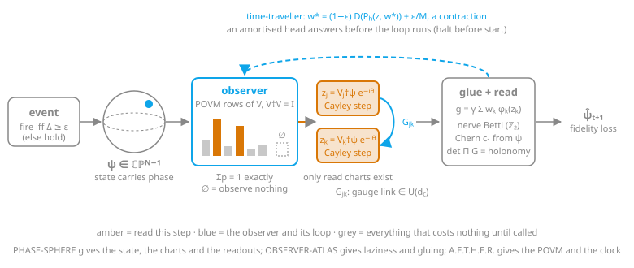
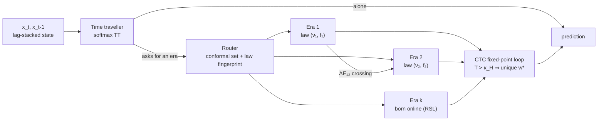
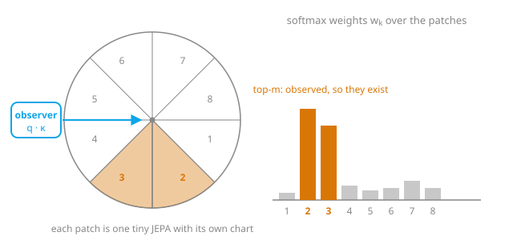
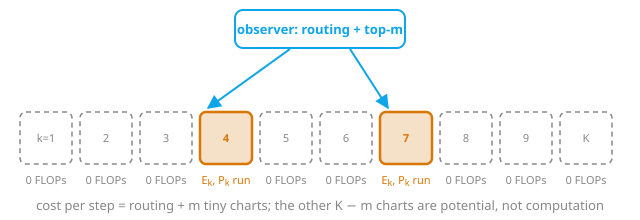
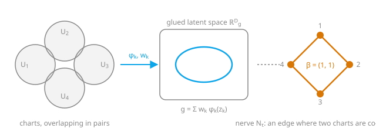
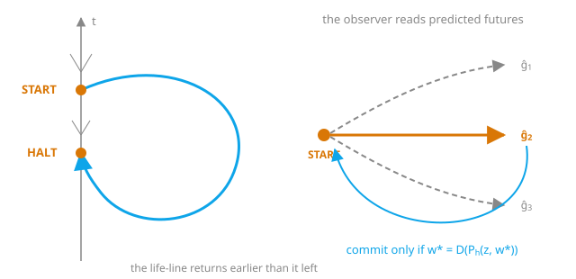
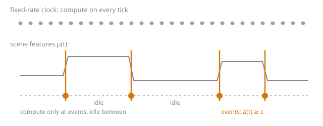

<h1 align="center">Asmodeous ०</h1>

<p align="center"><b>An atlas of tiny predictive worlds that exist only when an observer looks at them.</b></p>

<p align="center"><i>Asmodeus, king of demons, commands a legion. None of them is anywhere until it is called by name.<br/>
Called, one appears, does its work in its own small corner of the world, and is gone.</i></p>

<p align="center">
  
  
  
  
  
</p>

**Invented by [Teerth Sharma](https://teerthsharma.vercel.app/)** · teerths57@gmail.com

---

## Abstract

A measurement is the one step of quantum mechanics that is not linear, and it is the step that makes something real. Asmodeous ० takes that sentence as an engineering principle. The model is an **atlas of many tiny predictive charts**, each with its own small coordinate system, laid over a fragmented geometry. A **softmax observer** is the measurement: it decides which charts are read, and only the charts it reads are computed ("observed → exists"). The observer's weights are a partition of unity, so the charts it reads glue into one higher-dimensional space, and the pattern of which charts are read together is a nerve whose homology is the topology the model has learned. The observer is closed into a loop in the manner of a closed timelike curve: it reads the predicted futures of its candidate charts before it commits, and commits to the choice that is consistent with the future it causes. In time, as in space, nothing is computed unless something happens: an event-driven clock fires only on deviation.

The mathematics is quantum (linear superposition, then a measurement that breaks linearity). The machine is a classical consumer GPU. The idea is built as one architecture, **ASMODEOUS**, assembled slot by slot from the best part available for each slot. Its state is a point of complex projective space that carries its own phase. Its observer is a Parseval-frame POVM whose probabilities sum to one exactly, with an outcome for observing nothing. Its charts are gauge-fixed and exist only when read. Its gluing maps are learned unitary gauge links, its dynamics are unitary, and its loop is a damped fixed point that is guaranteed to converge. Its two parents, **OBSERVER-ATLAS** (real charts under a softmax observer) and **PHASE-SPHERE** (amplitudes on a sphere of phases under a Born decider), run beside it as first-class candidates. Every slot has a preregistered ablation, and measurements against owned baselines at equal active FLOPs and equal parameters decide which part earns each claim.

**Keywords:** observer, atlas of charts, partition of unity, lazy computation, Born rule, POVM, Chern number, holonomy, closed timelike curve, event-driven computation, JEPA.

---

## ASMODEOUS: one architecture, the best part in every slot

<p align="center"></p>

ASMODEOUS is not a committee of models. Each slot of the architecture was filled by asking which candidate part does that one job best, and the winner was taken whichever parent it came from. PHASE-SPHERE gives the state, the charts and the topological readouts. OBSERVER-ATLAS gives laziness and gluing. Seal's A.E.T.H.E.R. paper gives the adaptive measurement and the event clock. The CTC loop of the origin notes gives the observer its time-traveller. The full design, with the reason for every choice and the ablation that removes it, is in [`ASMODEOUS.md`](ASMODEOUS.md).

| Slot | Part chosen | From |
|---|---|---|
| state | $\psi=\mathrm{normalise}(E(o))\in\mathbb{CP}^{N-1}$: the phase is part of the state | PHASE-SPHERE |
| observer | Parseval-frame POVM: the rows $v_k$ of an isometry $V\in\mathbb{C}^{(K+1)\times N}$, $V^\dagger V=I$, plus one "observe nothing" row | A.E.T.H.E.R., Born, Naimark |
| charts | $z_k=V_k^\dagger\psi\,e^{-i\arg\alpha_k}$, gauge-fixed, computed only when read | PHASE-SPHERE |
| laziness in $K$ | score $K{+}1$ effects, run only the top $m$ charts; their weights are exact with no sum over $K$ | OBSERVER-ATLAS |
| laziness in time | event trigger, adiabatic re-route between events, per-chart send-on-delta | A.E.T.H.E.R. |
| gluing | learned gauge links $G_{jk}\in U(d_c)$ with a cocycle loss: a learned Čech cocycle | origin notes, PHASE-SPHERE |
| dynamics | $\hat z_k=\mathrm{Cayley}(X_k(a))\,z_k$, unitary | PHASE-SPHERE |
| observer loop | damped fixed point, a contraction; an amortised head answers before the loop runs | origin CTC, time-traveller |
| readouts | nerve Betti over $\mathbb{Z}_2$, Chern $c_1$ from $\psi$, holonomy $\det\prod G$ | both parents |
| training | fidelity $1-\lvert\langle\hat\psi_{t+1},\psi^{\mathrm{tgt}}_{t+1}\rangle\rvert^2$ on $\mathbb{CP}^{N-1}$, Haar test against collapse | origin, LeJEPA |

The observer is the heart of it. A $K\times N$ isometry with $K>N$ is a tight frame, so its rows already form a POVM with more outcomes than dimensions, and every probability is exact:

$$p_k=\big|\langle v_k,\psi\rangle\big|^2,\qquad \sum_{k=0}^{K}p_k=\psi^\dagger V^\dagger V\psi=1,\qquad \gamma=1-p_\varnothing$$

where $v_k$ is row $k$ of $V$, $p_\varnothing$ is the probability of the "observe nothing" row, and $\gamma$ is the gate. Because the probabilities need no partition function, the lazy top-$m$ weights are the same numbers the dense model would compute: laziness costs no approximation at all. The time-traveller is made a contraction by damping:

$$w\;\leftarrow\;(1-\varepsilon)\,D\big(P_h(z,w)\big)+\tfrac{\varepsilon}{M}\mathbf{1},\qquad \varepsilon>0$$

so the fixed point $w^\star$ exists, is unique, and is reached geometrically from any start. The loop no longer only promises an answer; it guarantees one.

The primitives these equations rest on are already test-bound (`tests/test_asmodeous_ops.py`, 16/16):

- the Stiefel retraction gives $V^\dagger V=I$ to $10^{-10}$ at $K\in\{16,65,257\}$;
- tight-frame probabilities are $\ge 0$ and sum to 1 to $10^{-10}$ with $K>N$;
- the damped loop converges to residual $<10^{-8}$ from 10 starts to one fixed point, while the undamped loop on a cycle does not;
- gauge links are unitary to $10^{-10}$ and satisfy the exact cocycle;
- fidelity is phase-invariant to $10^{-12}$;
- the Haar statistic separates Haar-random states from collapsed ones.

The `Asmodeous` class is being built test-first against its contract (`tests/test_asmodeous.py`), with a preregistered Hopf single-chart control that is allowed to take the chart slot on $S^2$ if it wins.

---

## FCPA: the Fluid Chrononal Predictive Architecture, and the road ahead

The next shape of Asmodeous ० is a **time traveller moving through a fluid of worlds**. Data is not one distribution. It is a *multiversal data fluid*: an ensemble of trajectories whose governing law changes from one stretch of time to the next. FCPA cuts that fluid into **eras**. An era is a time slice bounded on both sides by a **Markov bound** (the transition law changes) and a **Navier–Stokes bound** (the flow law, viscosity and forcing, changes), and each era holds its own small world model. A softmax **time traveller** answers alone when it can. When it cannot, it jumps into the era it needs. To cross from one era to the next it must compute the **differentiator** $\Delta E$, the change of the equations, and that change is also the **address** of where the data lives. The traveller closes the loop the way a closed timelike curve does: it reads the futures its own choice would cause, and commits only to a self-consistent one. New eras are born while the system runs, like hot reload in a game engine, so the model teaches itself: **recursive self-learning (RSL)**.



The whole architecture is written as lemmas first, proved in Lean 4, and implemented as one scikit-learn estimator (`FCPARegressor`, which passes `check_estimator`) whose `partial_fit` equals `fit` exactly, because every era keeps only additive sufficient statistics. The equations that carry it:

$$\text{era law:}\quad \partial_t\omega + u\cdot\nabla\omega = \nu_k\,\Delta\omega + f_k,\qquad \hat\nu_k = \frac{S_{RL}}{S_{LL}}\ \ \text{(exact projection, L8)}$$

$$\text{crossing and address:}\quad \Delta E_{jk} = (\nu_k-\nu_j,\ f_k-f_j,\ P_k-P_j),\qquad S_{jk} = \exp\!\Big(\textstyle\sum_a \Delta E_{jk}^{a}\,G_a\Big)\ \text{unitary (L13, L15)}$$

$$\text{time loop:}\quad w^\star = \mathrm{softmax}\!\Big(\tfrac{\beta}{T}A\,w^\star\Big)\ \text{is unique and reached geometrically whenever}\ T > \kappa_H = \tfrac{\beta}{4}\max_{ijkl}\big(A_{ik}-A_{jk}-A_{il}+A_{jl}\big)$$

$$\text{era birth:}\quad M_t = S_t + \tfrac{1}{t+1},\ \ S_t=(S_{t-1}+w_t)\,\kappa p_t^{\kappa-1},\qquad \Pr(\text{any false birth}) \le \delta\ \ \text{(Ville, L24*)}$$

### Where it stands

| Piece | State |
|---|---|
| Lemmas | L1–L27 with Amendments A–C, plus [Amendment D](docs/specs/2026-10-11-fcpa-amendment-D.md) (L28–L36: closed-loop error, horizon damping, linear insufficiency, the quadratic era model, CTC informativeness, calibration under dependence) |
| Lean 4 | 35 files, **0 `sorry`** ([`lean/`](lean/), [`CHANGES.md`](lean/CHANGES.md)), including the undamped CTC fixed point (`hilbert_ctc_fixed_point`), the birth false-alarm bound, exact `partial_fit` and split-conformal coverage |
| Estimator | [`fcpa/`](fcpa/): 373 tests pass (Inspector rerun); `check_estimator` 50 passed, 1 skipped |
| Seed-3 tuning bed | one-step error **0.0075 against persistence 0.030** (4× better); era identification from the estimated law **P3 = 0.928** against a 0.9 bar |
| Preregistration | Amendments 11, 11a and 11b frozen by sha256 before any evaluation result ([`docs/specs/`](docs/specs/)) |

### What we got wrong, and what it taught

- **A linear era model cannot win at fifty steps when its one-step map is composed.** The rollout gains energy through a momentum mode, and clipping the spectral radius does not touch it: $\sum_{j<50}\lVert \hat A^j\rVert$ is 4195 with or without clipping (L28). The best *direct* linear 50-step map sits exactly on persistence (L29). Any real long-horizon gain has to come from the quadratic advection term.
- **Damping buys the rollout and sells the butterfly.** Shrinking increments is a rescaling of the model's clock, so $\lambda_{\text{model}} \approx \gamma\,\lambda_{\text{data}}$, and the frozen butterfly bar needs $\gamma \gtrsim 0.8$ (L28c).
- **The first time loop ran too cold.** At $T=1$ the live loop sat 85× above $\kappa_H$ and refused every call. It cost nothing only because every blend had two eras, where the fixed point is uniform anyway (L32).
- **The first birth guarantee assumed independent windows.** Navier–Stokes windows are autocorrelated, and the unrepaired detector alarmed 74% of the time on null streams. Calibrating the running maximum across independent trajectories restores the bound with no assumption inside a trajectory ([E1](docs/specs/theory/E1_trajectory_calibrated_birth.md)).

### The plan

1. **Close the theory.** Amendment E brings in [L37](docs/specs/theory/L37_shift_equivariant_era_ridge.md), the shift-equivariant era ridge. Every law of the bed is exactly invariant under $x$-shifts and the $\pi$-rotation, so the era model is restricted to the symmetric subspace $V_Q$ by training on 34 shifted copies of each chunk. That is exactly the restricted ridge, it keeps `partial_fit` exact, it is never worse than the unconstrained fit on any sample, and it cuts the quadratic library from 272,000 to 22,780 parameters. Amendment E also carries [L28c](docs/specs/theory/L28c_damping_vs_butterfly.md) and the trajectory-calibrated birth rule E1. Preregistration 11c then freezes the resulting pins: κ = 0.8, CTC normalisation $q = 0.8$, trajectory-level calibration, and the law threshold re-picked on validation.
2. **Prove it in Lean.** Formalise L28–L37 and E1, and port the project from Lean v4.7.0 to the pinned v4.34.1. The few results Mathlib still lacks (Hoeffding for chains, Ky Fan, Krasnosel'skii–Mann) stay cited, never `sorry`.
3. **Build the era model.** Implement the $V_Q$ quadratic era ridge at $\gamma \ge 0.8$. It has to beat persistence at fifty steps on the tuning seed while keeping the one-step win and the butterfly bar. Measure the owned baselines (Global, ASMODEOUS) on the same seed so the real target is known.
4. **Run the primary claim.** Five evaluation seeds, P1–P4 with the compute rules, the Holm family S1–S5, and the kill rules as frozen. If the claim fails, FCPA stays behind a feature flag, and the report says exactly which bar it lost.
5. **Language.** Swap the Navier–Stokes bed for text. The time traveller becomes a true language model, eras become domains and periods of a corpus, and $\Delta E$ becomes the change of law between them: the address of where a fact lives.
6. **Recursive self-learning at scale.** Eras hot-reload while the system runs, provenance tags keep self-generated data from collapsing the model, and Shapley values retire eras that no longer pay their way. Every birth stays under its false-alarm bound.

---

## 1. Introduction

Computation has a hidden assumption: that the whole state is always there, waiting. A transformer holds every token against every token. A dense network runs every weight on every input. A fixed-rate renderer draws every frame whether or not anything moved. The world does not work like this. A quantum system is a superposition until it is measured, and what is measured is a *choice* of basis that the observer makes. The idea of this project is to build a learner that is made the same way: **nothing is computed until it is observed, and the observer decides what is worth observing.**

Picture a sphere cut into patches. Each patch is a small model of its own neighbourhood: a tiny predictor with its own few coordinates, valid only where it lives. No single patch covers the sphere. No single coordinate system ever can; that is a theorem, not a preference. The sphere is understood only by many small charts that agree where they overlap. Over the patches sits one decider, a softmax. It looks at the situation, assigns weight to the patches, and lets the heavy ones become real. The rest stay as potential: zero cost, zero parameters touched.

That picture carries a chain of ideas, and each link gives the next its reason.

1. **The observer.** Turing's watched-pot paradox, the quantum Zeno effect, says that a system measured often enough is frozen. The observer is not a spectator. It is part of the dynamics, and a model of computation that leaves it out leaves out the one operation that decides anything.
2. **Quantum mathematics as an abstraction.** Linear superposition, then a measurement that breaks linearity: that two-step structure runs perfectly well on a classical GPU as complex linear algebra followed by a normalisation. No quantum hardware, no quantum claim, only the maths, which is the part that was always worth having.
3. **Many tiny charts that become real only when observed.** The geometry is fragmented on purpose. Charts are cheap and numerous; compute is spent only on the few the observer chooses. Parameters scale with the number of charts and compute scales with the number *observed*.
4. **The best of both worlds.** Two designs carry the idea. OBSERVER-ATLAS is a real-valued atlas of tiny JEPAs under a softmax observer. PHASE-SPHERE is the design of the project's origin notes: a phase sphere under a Born-rule decider. HYBRID takes the best part of each. Nothing is bound to either side; the measurements pick the winner per claim.
5. **The time-traveller.** The observer is a closed loop. It reads the predicted futures of its candidate charts, and commits only to a choice that is consistent with the future it causes. START, travel, HALT: the answer reaches the decider before the decision.
6. **Time laziness.** The same principle applies to the clock. Computation fires at events and idles in between, as in the A.E.T.H.E.R. event-driven architecture.

That is the image the name carries. Asmodeus rules a legion, and the legion costs nothing until it is summoned: the king names a few, those few appear and act in their own small corner of the world, and the rest remain names. Here the legion is the atlas of charts, the summons is the observer's softmax, and the corner each one acts in is its chart.

The result is a model whose cost follows what matters, whose parameters grow without its compute growing, and whose learned structure can be *read out as a topology* (an integer, a Betti vector, a holonomy) instead of being inferred after the fact.

> This is something new. It is not JEPA, and it is not self-attention. JEPA, mixture-of-experts and attention are vocabulary and baselines here, not constraints.

---

## 2. Background

### Why an observer?

An observer is the point where a continuum of possibilities becomes one outcome. Quantum mechanics names the operation (measurement), attention names its classical cousin (softmax over keys), and the body gives the everyday example: an intention picks a goal, and the geometry of the body computes the path. In every case there is a small decider on top and a rich local mechanism below, and the decider only has to pick, not to compute.

The paradox that opens the project is that **the more often a system is watched, the less it moves**. Rotate a spin by a half-turn in $N$ equal steps and measure after each step; the survival probability of the starting state is

$$P_{\mathrm{surv}}(N)=\cos^{2N}\!\left(\frac{\pi}{2N}\right)\;\xrightarrow{\;N\to\infty\;}\;1$$

where $N$ is the number of measurements during the rotation and $P_{\mathrm{surv}}$ is the probability that every measurement finds the system still in its starting state. The observer changes what the system does. This is the first sign that an observer is a dynamical object and not a readout.

### Prior Art

Every part of the design has a closest owner. The table names what each owns and what Asmodeous ० adds on top. Each owner is a baseline, a source of vocabulary, and a point of comparison.

| Work | What it owns | What Asmodeous ० adds |
|---|---|---|
| **MoP-JEPA** (arXiv [2607.05238v1](https://arxiv.org/abs/2607.05238)) | A context-only softmax router over K JEPA predictor heads on a shared encoder, with hard winner-take-all selection; fixes conditional-mean collapse. | A separate chart (encoder and embedding space) for every JEPA; lazy evaluation, so unselected charts cost nothing; gluing of charts into a higher-dimensional space; a topology readout from the observer. |
| **Chart Auto-Encoders** (arXiv [1912.10094](https://arxiv.org/abs/1912.10094)) | Atlases of local charts with learned encoders, decoders and chart membership, for auto-encoding manifolds. | Predictive (JEPA) charts instead of reconstruction; an observer that routes among charts; lazy top-m evaluation; online nerve topology. |
| **POUnets** (arXiv [2101.11256](https://arxiv.org/abs/2101.11256)) | Learned partitions of unity that glue local approximations, for regression. | Partition of unity as an observer over latent world-model charts; laziness; a nerve readout of the cover that was learned. |
| **PEER** (arXiv [2407.04153](https://arxiv.org/abs/2407.04153)) | Retrieval of a few experts out of a very large pool by product keys; parameters grow while compute stays fixed. | Experts that are charts with their own coordinates, glued into one space, with the topology of their co-selection read out. |
| **LeJEPA / SIGReg** (arXiv [2511.08544](https://arxiv.org/abs/2511.08544)) | An anti-collapse regulariser (SIGReg) for joint-embedding predictive learning. | SIGReg applied per chart and on the glued latent; observer competition as a second, independent anti-collapse mechanism, tested by ablation. |
| **V-JEPA 2** (arXiv [2506.09985](https://arxiv.org/abs/2506.09985)) | Action-conditioned latent world models used for planning by model-predictive control. | An observer that reads the predicted futures of candidate charts before committing: a closed-loop decider with a fixed-point condition. |
| **Mixture-of-Depths** | Per-token dynamic allocation of compute across layers. | Allocation across charts and across time, with the allocation itself carrying a topological readout. |
| **Mapper** (Singh, Mémoli, Carlsson) | Post-hoc topological summary of a data cloud through a cover and its nerve. | The cover is learned online by the observer, so the nerve is read from the model while it runs. |

---

## 3. Theoretical Foundation

Every object below is implemented in `atlas/`, and every identity is checked in `ref/` and the tests (Section 5).

### 3.1 Superposition, then a measurement that breaks linearity

A state is a unit vector $\psi$ expanded in a basis $\{u_k\}$. Evolution is linear. The **decider** is the Born rule, the one non-linear step:

$$|\psi\rangle=\sum_k \alpha_k\,|u_k\rangle,\qquad \alpha_k=\langle u_k|\psi\rangle$$

$$p_k=\frac{|\alpha_k|^2}{\sum_j|\alpha_j|^2}=\mathrm{softmax}\big(2\log|\alpha_k|\big)_k$$

Here $\alpha_k$ is the amplitude of $\psi$ along the chart gauge $u_k$ and $p_k$ is the probability of observing chart $k$. The second line is an exact identity, so a Born decider is a softmax over log-magnitudes. Softmax attention is a classical observer; the Born rule is its coherent form, and the two meet at one formula.

### 3.2 Measurement as a POVM

A measurement that can be rotated, and therefore learned, is a positive operator-valued measure:

$$E_k=U^\dagger \Pi_k\, U,\qquad \Pi_k=|k\rangle\langle k|,\qquad \sum_k E_k=U^\dagger\Big(\sum_k\Pi_k\Big)U=I,\qquad E_k\succeq 0$$

where $U$ is a unitary with learnable parameters, $\Pi_k$ is the fixed projector onto basis state $k$, and $E_k$ is the effect that selects outcome $k$. Completeness $\sum_k E_k=I$ holds for every value of the parameters, so the measurement stays valid while it learns, and $p_k=\langle\psi|E_k|\psi\rangle$.

### 3.3 The softmax observer is a partition of unity; charts glue into $\mathbb{R}^{D_g}$

The observer scores every chart against a query and normalises:

$$w_k(x)=\mathrm{softmax}_k\!\left(\frac{q(x)\cdot\kappa_k}{\sqrt d}\right),\qquad w_k(x)\ge 0,\qquad \sum_k w_k(x)=1$$

where $q(x)$ is the query computed from the context at input $x$, $\kappa_k$ is the learned key of chart $k$, and $d$ is the key width. The weights sum to one at every input, which is the definition of a partition of unity subordinate to the cover by chart domains. Keep the heaviest $m$ charts $S=\text{top-}m(w)$ and renormalise. Chart $k$ encodes the observation into its own small coordinates $z_k=E_k(o)\in\mathbb{R}^{d_c}$ and a gluing map $\phi_k:\mathbb{R}^{d_c}\to\mathbb{R}^{D_g}$ with $D_g>d_c$ places it in the shared space:

$$g=\gamma\sum_{k\in S}\tilde w_k\,\phi_k(z_k),\qquad \tilde w_k=\frac{w_k}{\sum_{j\in S}w_j}$$

where $\gamma\in[0,1]$ is a learned gate that lets the observer observe nothing (a causal softmax with no gate collapses onto a single token; see Section 5), and $g$ is the glued latent. Predictions glue the same way: $\hat g_{t+1}=\gamma\sum_{k\in S}\tilde w_k\,\phi_k\big(P_k(z_k,a_t)\big)$, with $P_k$ the tiny predictor of chart $k$ and $a_t$ the action.

### 3.4 The lazy rule: observed → exists

Only the charts in $S$ run their encoder and predictor. Unselected charts are never read. The cost of a step is routing plus $m$ tiny charts:

$$C_{\text{step}}=C_{\text{route}}+m\,C_{\text{chart}},\qquad C_{\text{route}}=O(K\,d)\ \text{(flat keys)}\ \text{ or }\ O(\sqrt K\,d)\ \text{(product keys)}$$

where $K$ is the number of charts, $m\ll K$ the number observed, and $C_{\text{chart}}$ the cost of one tiny JEPA. The dense reference costs $K\,C_{\text{chart}}$. Parameters grow with $K$, compute does not. The lazy top-$m$ computation is checked against the dense mixture that zeroes the same weights (parity), and the unselected charts are checked to cost nothing.

### 3.5 How many charts does a manifold need?

No single chart covers a closed manifold without tearing (invariance of domain). With $\mathrm{cat}$ the Lusternik–Schnirelmann category and $\mathrm{atlas}(M)$ the least number of ball charts that cover $M$:

$$\mathrm{cat}(M)+1\;\le\;\mathrm{atlas}(M)\;\le\;n+1,\qquad n=\dim M$$

By these bounds the sphere $S^n$ needs 2 charts, the torus $T^2$ and the Klein bottle need 3, and $SO(3)\cong\mathbb{RP}^3$ needs 4. The atlas stops tearing at $K=\mathrm{atlas}(M)$, and not before. A rotation in $SO(3)$ has no continuous representation in four Euclidean dimensions or fewer, while five or six suffice, which is why the charts are glued into a space of higher dimension than their own.

### 3.6 The nerve of the observer and its Betti numbers

Charts that are read together form a simplicial complex. For a threshold $\tau$:

$$N_\tau=\Big\{\sigma=\{k_0,\dots,k_r\}\;:\;\exists\,x\ \text{with}\ w_{k_i}(x)\ge\tau\ \ \forall i\Big\}$$

$$\beta_j=\dim_{\mathbb{Z}_2}H_j\big(N_\tau;\mathbb{Z}_2\big)$$

Here the vertices are the charts, a simplex is a set of charts co-selected with weight at least $\tau$ on some input, and $\beta_j$ is the $j$-th Betti number over $\mathbb{Z}_2$. By the nerve theorem a good cover has the homotopy type of its nerve, so the learned topology can be read from the observer while the model runs. Over $\mathbb{Z}_2$ the targets are $S^2:(1,0,1)$, $T^2:(1,2,1)$, $\mathbb{RP}^3:(1,1,1,1)$. A partition of unity places at most $\lfloor 1/\tau\rfloor$ charts above $\tau$, and a top-$m$ nerve has dimension at most $m-1$; both bounds are properties of the readout and are accounted for in its design.

### 3.7 The phase sphere: amplitudes, transition phases, Chern number, holonomy

The origin notes read "jepa as a phase over higher dimensional $S^2$ sphere; small phases all around the sphere; the decider will be a softmax". In this reading the state is a point of projective Hilbert space, $\psi\in\mathbb{CP}^{N-1}$ (the Bloch sphere $\mathbb{CP}^1=S^2$ is the first case), and the small phases are the $U(1)$ fibre. Each chart is a local gauge:

$$\alpha_k=\langle u_k|\psi\rangle,\qquad z_k=V_k^{\dagger}\psi\,e^{-i\arg\alpha_k},\qquad \hat z_k=\mathrm{Cayley}\big(X_k(a)-X_k(a)^{\dagger}\big)\,z_k$$

where $u_k\in\mathbb{C}^N$ is the learned gauge of chart $k$, $V_k$ a learned frame, the factor $e^{-i\arg\alpha_k}$ fixes the gauge so that $g$ does not depend on the global phase of $\psi$, and $\hat z_k$ is the local unitary step driven by the action $a$ (a Cayley transform of a skew-Hermitian generator is unitary). Neighbouring gauges differ by a **transition phase**:

$$\chi_{jk}=\arg\big(\alpha_j\,\overline{\alpha_k}\big)$$

and the topological readout is an integer. For a triangulated sphere of states, take the link variables $U_{ab}=\langle\psi_a|\psi_b\rangle/|\langle\psi_a|\psi_b\rangle|$ and the plaquette field strength $F_\square=\arg\!\big(U_{12}U_{23}U_{31}\big)$ on the principal branch. The lattice **Chern number** (Fukui–Hatsugai–Suzuki) is

$$c_1=\frac{1}{2\pi}\sum_{\square}F_\square$$

where the sum runs over the oriented triangles of the lattice and $c_1\in\mathbb{Z}$ up to an orientation convention. Its magnitude is 1 for the Hopf bundle $S^3\to S^2$, the spin-½ monopole, and 0 for a trivial bundle. Along a closed path the same links give the **Berry phase**, the holonomy of the state:

$$\gamma(C)=-\arg\prod_j\langle\psi_j|\psi_{j+1}\rangle,\qquad \gamma=-\tfrac12\,\Omega\ \ \text{(spin-½)}$$

where $C$ is the closed loop of states and $\Omega$ is the solid angle the loop encloses on the sphere. A transported frame returns with a sign $\pm1$ around the non-orientable loop of a Klein bottle and with sign $+1$ around every loop of a torus, so the holonomy sign separates the two surfaces at the level of individual loops.

### 3.8 The closed loop: the observer as a fixed point

The loop in the origin notes, the observer's closed time-like curve, is a self-consistency condition (Deutsch's condition $x=F(x)$):

$$w^\star=D\big(P_h(z,\,w^\star)\big),\qquad w^{(i+1)}=D\big(P_h(z,\,w^{(i)})\big),\qquad \text{halt when } \|w^{(i+1)}-w^{(i)}\|<\varepsilon$$

where $z$ is the current state, $w$ the observer's choice of charts, $P_h(z,w)$ the predicted state $h$ steps ahead when the charts $w$ are read, and $D$ the decider that maps a predicted future to a choice. The observer's choice must equal the choice it would make after seeing the future that choice causes. A continuous map of the simplex into itself always has a fixed point (Brouwer), so the loop always has an answer and there is no paradox. The Gödel figure of the origin shows the same shape: the halting answer returns to the axis *before* the start event. An **amortised head** learns $\hat w(z)\approx w^\star(z)$ in one shot (trained by a KL divergence to the converged $w^\star$), so the answer exists before the iteration that defines it runs.

### 3.9 The butterfly bonded by topology

The continuous state may be chaotic while the integer readout stays put. With $J_t$ the Jacobian of the latent rollout at step $t$,

$$\lambda_1=\frac1h\log\Big\|\prod_{t=1}^{h}J_t\Big\|$$

is the finite-time largest Lyapunov exponent over the horizon $h$. The claim is that $\lambda_1>0$ (the continuous dynamics is sensitive) while the discrete readouts ($c_1$, the holonomy class, the Betti vector) cannot change under small perturbations unless a gap closes. The butterfly is bonded by topology.

### 3.10 Event-driven time laziness (A.E.T.H.E.R.)

The A.E.T.H.E.R. event-driven architecture renders a frame only when the scene has changed enough. With $\mu(t)\in\mathbb{R}^d$ the scene-feature vector, the deviation and the trigger rule are

$$\Delta(t)=\big\|\mu(t)-\mu(t-\delta t)\big\|_2,\qquad \text{fire iff }\ \Delta(t)\ge\epsilon$$

and, with $v(t)=\tfrac{d}{dt}\|\mu(t)\|$, the effective rate and the number of frames over a duration $T$ are

$$\mathrm{FPS}(t)\approx\frac{\|\dot\mu(t)\|}{\epsilon(t)},\qquad N_f=\int_0^T\mathrm{FPS}(t)\,dt\approx\int_0^T\frac{\|\dot\mu(t)\|}{\epsilon(t)}\,dt$$

where $\epsilon(t)$ is a threshold that the controller adapts, so the system raises it in noise and lowers it when motion matters. The same paper defines the adaptive measurement as a POVM $E_k(\Phi)=U^\dagger(\Phi)\,\Pi_k\,U(\Phi)$ with $\sum_k E_k=I$ for every parameter $\Phi$, which is exactly the measurement of Section 3.2. The two laziness axes compose: space decides *which charts* run (Section 3.4) and time decides *at which instants* anything runs at all.

---

## 4. The parents, and the parts ASMODEOUS is made from

ASMODEOUS takes its parts from two parents, and both parents also run in full as first-class candidates. Every model runs on the same beds, seeds and metrics through one contract (`common.py`). A part that wins is kept and built on; a part that loses is replaced.

### 4.1 OBSERVER-ATLAS

<p align="center"></p>

The atlas is **K tiny JEPAs** with private charts. Chart $k$ has an encoder $E_k:o_t\to z_k\in\mathbb{R}^{d_c}$ with $d_c$ small, a predictor $P_k:(z_k,a_t)\to\hat z_k$ in the same chart, a stop-gradient or EMA target encoder, and a gluing map $\phi_k$. A small causal backbone produces the context $c_t$, the observer turns it into the weights of Section 3.3, a gate lets it observe nothing, and only the top-$m$ charts run.

<p align="center"></p>

<p align="center"></p>

The loss is the sum of: a per-chart JEPA loss against the stop-gradient target in the same chart, an overlap consistency term that makes co-selected charts agree in $\mathbb{R}^{D_g}$, SIGReg per chart and on $g$, a router load-balance term, and the task loss through $g$. Every structure the model uses (charts, routing, gluing, the manifold itself) is learned by SGD; hand-given structure scores as "representable only", never as "works".

### 4.2 PHASE-SPHERE

The design of the origin notes, built as: $\psi_t=\mathrm{normalise}(E(o_t))\in\mathbb{C}^N$; $K$ learned chart gauges $u_k$ and a null gauge $u_\varnothing$; a Born decider with a "nothing" outcome ($\gamma=1-p_\varnothing$); lazy gauge-fixed charts $z_k$ for the top-$m$ only; a Cayley-unitary local dynamics; glue $g=\gamma\sum_k\tilde w_k\,\phi_k([\mathrm{Re}\,z_k,\mathrm{Im}\,z_k])$; transition phases $\chi_{jk}$; and the closed-loop observer of Section 3.8 with its amortised head. Its readouts are the Chern number of Section 3.7 and the Berry holonomy along held-out loops. Because amplitudes enter only through $K\cdot N$ Born scores, $K$ needs no product keys.

### 4.3 HYBRID

`HybridAtlas` is the composition of three parts: the real charts of OBSERVER-ATLAS, the coherent decider $p=|U\psi|^2$ with $\psi_k=\sqrt{\mathrm{softmax}(s)_k}\,e^{i\theta_k(q)}$ and $U$ a low-rank Cayley rotation, and the time-traveller loop (START preselects $M$ charts, the life-line rolls their candidate futures, HALT is the self-consistent set). Nothing is bound together by hand: every part has a limit in which it vanishes, and the arm starts at those limits.

$$\text{no coherence, no phase}\ \Rightarrow\ \text{OBSERVER-ATLAS},\qquad \text{no loop}\ \Rightarrow\ \text{coherent decider},\qquad \text{no coherence}\ \Rightarrow\ \text{time-traveller atlas}$$

so the hybrid contains OBSERVER-ATLAS, the coherent atlas and the time-traveller atlas as special cases, and learns how far from each to move.

### 4.4 The time-traveller

<p align="center"></p>

The origin figure of the notes is the Gödel-universe closed timelike curve: a life-line that leaves the axis at START, spirals out to where the angular circles turn time-like, rides them backward in $t$, and returns to the axis at HALT, earlier than it left. In the architecture the life-line is the roll-out of candidate futures, and HALT is the self-consistent choice. The observer does not guess a chart and then find out. It reads what each candidate would predict and commits to the choice that survives its own prediction, and an amortised head learns to produce that choice in a single pass.

### 4.5 Event-driven time

<p align="center"></p>

The A.E.T.H.E.R. paper moves the same laziness into time. Computation is triggered by a deviation $\Delta(t)\ge\epsilon$, so a quiet scene costs nothing and a busy one costs what it must. Combined with the lazy charts, a step is paid for only when something happened *and* only on the charts that the observer chose.

### 4.6 The owned arms: fair baselines

Every owned method is a baseline, built to the same contract, trained by SGD, and matched to the atlas at **equal active FLOPs and equal total parameters** (`arms/match.py`, preregistered in `PREREG_DRAFT_arms.md`). Where one configuration cannot hit both targets, two baselines run, one per axis, and the atlas must beat each on the axis it is matched on.

| Arm | Role |
|---|---|
| Single JEPA, at several latent widths | The Whitney baseline: one chart wide enough to embed the manifold. |
| MoP-JEPA (dense and lazy) | The closest owner: K predictor heads on a shared encoder behind a context-only softmax router. |
| Chart-AE JEPA | Owner of separate charts and gluing, with membership over all K charts. |
| Lazy chart-AE JEPA | The observer ablation: the atlas without the backbone, the gate and the keys. |
| PEER-JEPA | The owned route to "parameters grow, compute stays fixed" by product-key experts. |
| CEM planner | V-JEPA-2-AC-style model-predictive control over any arm's rollout, with planning compute equalised across arms. |

---

## 5. Verified identities

Everything the mathematics stands on is a checked identity before it is a design. Every line below is produced by `ref/identities.py` (pinned by SHA-256) or asserted by a passing test in `tests/` (`test_facts.py`, `test_phase_sphere.py`, `test_coherent_observer.py`, `test_povm.py`, `test_asmodeous_ops.py`, `test_t6.py`, `test_observer_atlas.py`, `test_arms.py`, `test_topology.py`, `test_bench_t7.py`).

```
━━━━━━━━━━━━━━━━━━━━━━━━━━━━━━━━━━━━━━━━━━━━━━━━━━━━━━━━━━━━━━━━━━━━━━━━━━━━━━━━━━━━━
  ASMODEOUS ०   ·   verified identities
━━━━━━━━━━━━━━━━━━━━━━━━━━━━━━━━━━━━━━━━━━━━━━━━━━━━━━━━━━━━━━━━━━━━━━━━━━━━━━━━━━━━━━━
  Pin        SHA-256 of ref/identities.py      467c2ae2…40a3fe   matches the pin
  Zeno       cos^(2N)(π/2N), N=1,2,10,100,1000  0.000000 0.250000 0.780546 0.975627 0.997536
                                               simulated survival equal to 6 decimals
  Born       p = softmax(2 log|α|)              = |α|²/Σ|α|²   atol 1e-12, 100×9 complex128
  Lüders     max|QQ|, pure and mixed states     < 1e-14        QQ equality holds
  Classical  mean|QQ|, + disturbance            0.0751         QQ equality breaks
  Softmax    causal stack, mass on token 1      0.2543 (L=1) → 1.0000 (L=16)
  IIA        p1/p2, key 3 present / removed     softmax 1.3499 / 1.3499
                                               coherent g=1  2.0587 / 1.3499
  Cayley     U†U = I, 50 random generators      atol 1e-10
  POVM       Σ_k E_k = I, E_k ⪰ 0, K = N and     atol 1e-10; Naimark K > N via isometry V,
             K > N (Naimark), 50 draws each       Born p = |Uψ|², Σ p = 1
  Parity     lazy top-m == dense masked mix     atol 1e-10 (float64), K=8 flat, K=16 product keys
  Laziness   unselected charts NaN-poisoned     g, ĝ, loss unchanged (atol 1e-12); dense control → NaN
  FLOPs      active MACs, m vs K                per-chart cost exact in m; K enters only the router
  Kernel     fused Triton step == observe()     1e-4, K = 16 … 4096, flat and product keys
  Berry      γ = −Ω/2, spin-½ latitude loops     5/5 latitudes; 200 triangles exact to 1e-9
  Chern      FHS lattice, levels 2, 3, 4         spin-½ −1 · spin-1 −2 · trivial 0
  Holonomy   transported sign                    Klein −1 · torus +1
  Fixed pt   w* = D(P(z, w*)), 1000 stochastic    residual < 1e-8
  Betti Z2   S² · T² · Klein · RP³               (1,0,1) · (1,2,1) · (1,2,1) · (1,1,1,1)
  Betti Q    T² · Klein                          (1,2,1) · (1,1,0)
  Nerve      top-m readout, 20 seeds             dim ≤ m−1; PoU at τ: dim ≤ ⌊1/τ⌋−1
  Frame      V†V = I, Stiefel retraction         < 1e-10 at K = 16, 65, 257
  Tight      Σp = 1 for K > N outcomes            < 1e-10, p ≥ 0
  CTC loop   damped fixed point                  residual < 1e-8; unique from 10 starts
  Links      G_jk unitary, exact cocycle          < 1e-10
━━━━━━━━━━━━━━━━━━━━━━━━━━━━━━━━━━━━━━━━━━━━━━━━━━━━━━━━━━━━━━━━━━━━━━━━━━━━━━━━━━━━━━━━━━━━━━━
```

---

## 6. The experiments

Each claim of the project is a question put to a measurement. The beds, the bars and the kills are written into [`PREREG.md`](PREREG.md) and committed before any result file exists, and every claim is scored for all three candidates under the same beds, seeds, matched sizes and owned baselines. The verdict for a claim names whichever candidate passes it.

| Test | The question |
|---|---|
| **T0** reproduce | Does `ref/identities.py` reproduce its pinned output? |
| **T1** owner hunt | Is the full combination already owned? Every owned part is cited and used as a baseline. |
| **T2** geometry (C1, C2) | On the sphere, torus, Klein bottle and $SO(3)$, with no manifold, chart or state ever given, does the atlas stop tearing at exactly $K=\mathrm{atlas}(M)$ with charts of the manifold's own dimension, and does the nerve recover the true Betti numbers online? A neutral flat bed runs beside them. |
| **T3** lazy scaling (C3) | At fixed active compute, does loss fall as the number of charts $K$ grows, below a dense JEPA and below one JEPA with PEER experts? Does lazy top-$m$ stay within tolerance of the soft mixture over all $K$? |
| **T4** collapse (C4) | With the anti-collapse regulariser weakened or removed, does observer competition keep the representation from collapsing? Does the atlas match MoP-JEPA on mode collapse on OGBench pointmaze-stitch? |
| **T5** time-traveller (C5) | Does reading predicted futures before committing beat owned latent MPC at equal planning compute, on MuJoCo swing-up and OGBench pointmaze? |
| **T6** contextuality | Do query pairs show order effects and QQ-equality statistics as a quantum-structured observer predicts? Measurement only. |
| **T7** systems | Do lazy routing and tiny JEPAs run faster on an RTX 4060 than a dense JEPA of equal quality? |

The origin-derived readouts are scored alongside, for every candidate where they are defined:

| Test | The question |
|---|---|
| **TO1** Chern | Does the learned amplitude bundle read $|c_1|=1$ on the Berry bed and $0$ on its trivial control? |
| **TO2** fixed point | Does the closed-loop observer converge, and does it beat one-pass routing at equal FLOPs? |
| **TO3** halt before start | Does a one-shot head predict the converged $w^\star$ at a fraction of the loop's cost? |
| **TO4** butterfly | Is $\lambda_1>0$ while the integer readouts stay put under perturbation? |
| **TO5** scattering front end | Does a multiscale scattering cascade reach the same prediction quality in fewer steps? |
| **TO6** rays through a lattice | Does ray-cast selection over a grid of charts match product keys at lower cost? |
| **TO7** holonomy | Does the sign of the holonomy along held-out loops separate the torus from the Klein bottle? |

The hybrid is held to the "best of both" claim directly: on each claim it must be at least as good as the better parent, and strictly better than both on at least one preregistered claim. Ablations that switch each part off decide which part earned a win.

---

## 7. Quick Start

```bash
cd zero

# T0: the reference identities (numpy only); compare with ref/identities.out
python ref/identities.py

# the observer-atlas tests
python -m pytest tests/test_observer_atlas.py -q

# the Berry, Chern and Betti fact tests
python -m pytest tests/test_facts.py -q

# the owned baselines: contracts, laziness, MoP-JEPA fidelity
python -m pytest tests/test_arms.py -q

# size every owned arm against the atlas at equal active FLOPs and equal parameters
python -m arms.match
```

The build targets Python 3.11, torch 2.14 and a single consumer GPU (an RTX 4060). No quantum hardware is involved.

---

## 8. Layout

```
zero/
├── ASMODEOUS.md                the architecture, slot by slot
├── atlas/                      ASMODEOUS and its parents
│   ├── asmodeous.py            ASMODEOUS: Parseval POVM, gauge links, damped CTC loop
│   ├── observer_atlas.py       OBSERVER-ATLAS: tiny JEPAs, gated softmax observer, lazy top-m, gluing
│   ├── phase_sphere.py         PHASE-SPHERE: Born decider, gauge-fixed charts, Chern, holonomy, fixed point
│   ├── coherent_observer.py    the coherent (Born, phased) decider on atlas charts
│   ├── povm.py                 projective and Naimark POVMs
│   ├── time_traveller.py       the START / life-line / HALT planning loop
│   └── hybrid.py               HYBRID: atlas + coherent decider + time-traveller
├── fcpa/                       FCPA: the scikit-learn estimator, beds, bars and the primary runner
├── lean/                       Lean 4 proofs of the FCPA lemmas (0 sorry)
├── docs/specs/                 FCPA spec, amendments, preregistration, freezes, errata, audits
├── arms/                       the owned baselines, matched at equal active FLOPs and params
│   ├── single_jepa.py  mop_jepa.py  chart_ae.py  lazy_chart_ae.py  peer_jepa.py
│   ├── planner.py              CEM planner
│   └── match.py                L-BR sizing
├── docs/fig/                    the five diagrams of this README
├── beds/                       neutral and designed beds (manifolds, Berry, swing-up, OGBench)
├── ref/                        reference identities, Berry and Betti checkers, triangulations, origin notes
├── tests/                      pytest suites for every module above
├── metrics.py                  discontinuity, nerve Betti, effective rank, chart transitions, holonomy
├── sigreg.py                   shared anti-collapse regulariser
├── common.py                   the contract every arm and bed obeys
├── PROMPT.md  ORIGIN.md        the OBSERVER-ATLAS spec and the origin's design
└── PREREG.md                   bars and kills, committed before any result
```

---

## License

Attribution License. Free to use, copy, modify and distribute, provided that the original creator, Teerth Sharma, is credited as the inventor. See [`LICENSE`](../LICENSE).

---

<p align="center"><i>Invented by <a href="https://teerthsharma.vercel.app">Teerth Sharma</a></i></p>
